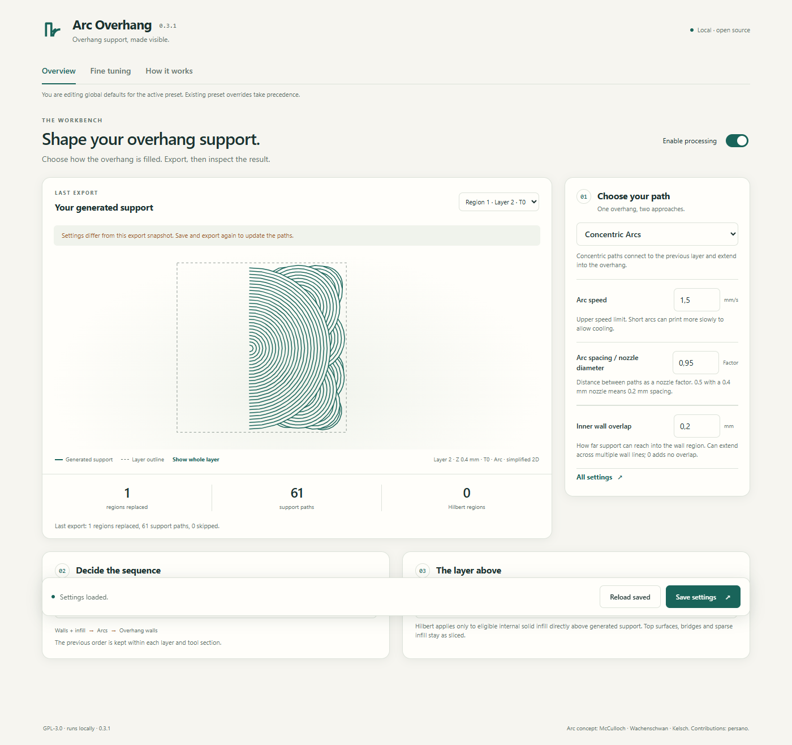
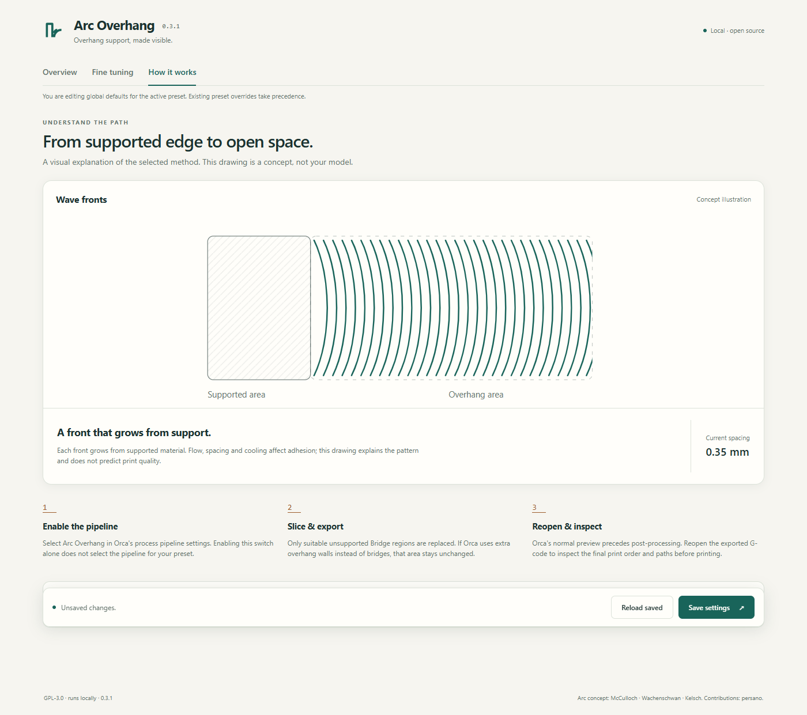
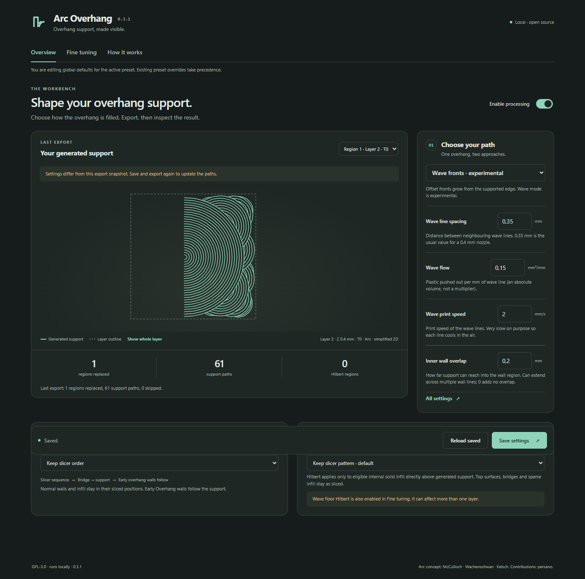

# Workbench UX — 0.3.1

## Intent

A local workbench for configuring, inspecting and explaining Arc/Wave toolpaths.
The interface uses project-authored HTML, CSS and SVG illustrations with no remote
assets or rendering dependencies. Printer behavior and display settings are separate.

## Information hierarchy

1. Overview: method, three/four relevant parameters, print order and next-layer infill.
2. Fine tuning: grouped expert controls, retaining every configuration key.
3. How it works: a purpose-drawn schematic and the actual enable/slice/export/reopen workflow.

The look uses warm neutral surfaces, restrained green paths, orange annotations,
horizontal navigation and ordinary native controls. There are no licence or trial
controls. Existing GPL licensing and contributor attribution are preserved.

## Truthful graphical feedback

The exported-support view uses the engine's generated paths and layer outlines;
it is not a fabricated model or a live simulation. The development layer player indexes all generated regions and loads geometry for
one selected region at a time. It extracts support motions after final scheduling
and animates their actual order. Layer outlines are simplified for context. See
[AUTOMATIC_PREVIEW.md](AUTOMATIC_PREVIEW.md) for playback and validation details.

A snapshot keeps its source settings so a mismatch can be shown after edits.
There is no unsupported claim that the tab detects model or project changes.
The schematic is explicitly labelled and changes only to explain the selected
method/spacing. A presentation error cannot fail an otherwise successful export.
Geometry stays in the local in-memory report and is omitted from pipeline logs.

## Input and save behaviour

All existing controls and new workbench settings are rendered once. Mode changes hide irrelevant groups without
resetting them. Unsaved edits survive focus changes in this view; Reload saved
explicitly discards them. No persistent cross-preset draft is restored.
Save waits for the actual host acknowledgement. The existing preset/global scope
and preset-override notice remain visible. Read-only state and validation failures
are reported; no success is claimed on a failed save.

## Checks

The browser test exercises actual DOM rendering, stored settings, mode/order
selection, the Hilbert-floor interaction, scheme changes, 390 px width, drafts,
read-only mode and safe text rendering. It also asserts zero HTTP(S) requests.
Engine regressions compare output with the released 0.3.0 version, allowing only
version comments to differ. The native Orca bridge and strict file-access audit
remain part of validation. The 0.3.0 release and tag are not overwritten.

## Own UI screenshots

Screenshots use the project's synthetic export fixture.

